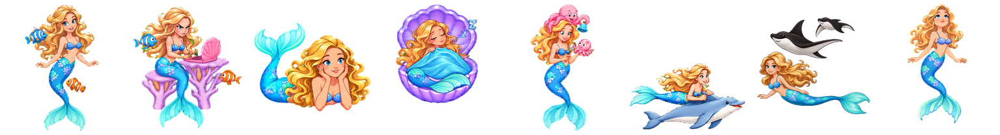

# Sirena 🧜‍♀️ (Orca pet)

A mermaid desktop pet for **Claude Code** on Windows. She floats on top of your screen and reacts to what your Claude Code sessions are doing: coding at her coral desk while Claude works, calling you from her belly when Claude is waiting for you, and falling asleep in her scallop-shell bed when you're away. It works with any Claude Code session on the machine (terminal, VS Code, or inside Orca).




## What she does and when

| Situation | Sirena | Then |
|---|---|---|
| Claude is working | codes at the **Coral Desk** | until Claude stops |
| A tool call fails | a short **Sad Sigh** | back to the desk |
| A whole turn fails | **Sad Sigh** + "‹project› hit an error" | waits for you |
| Claude waits for you (finished, or needs your OK) | lies on her belly blowing bubbles, with a bubble: "‹project› is waiting for you" / "‹project› needs your OK" | after 2 min with no answer: falls asleep |
| Asleep | climbs into the **Scallop-Shell Bed**, then sleeps and breathes, Zz rising | climbs out when Claude works again |
| Nothing going on | **Idle with Fish**; her eyes follow your mouse; now and then she swims | after 5 min: falls asleep |
| You hover over her | **Octopus Review** + a bubble with every session's status | |
| You drag her right / left | rides the **dolphin** / glides with the **mantas** | |

With several sessions open, the most urgent one wins: needs you > error > working > asleep. Right-click her for size, swimming on/off, hide for an hour, or quit.

## Install (Windows; tested with Python 3.13)

```bat
git clone https://github.com/BrandAlchemyStudio/sirena-orca-pet.git %USERPROFILE%\.claude\pets\sirena
cd %USERPROFILE%\.claude\pets\sirena
pip install -r requirements.txt
python install_hooks.py
start-sirena.cmd
```

`install_hooks.py` adds Sirena's hooks to `~\.claude\settings.json`. It backs up the file first, leaves your other hooks alone, and is safe to run twice. To remove her hooks, run `python install_hooks.py --remove`.

To start her with Windows, put a shortcut to `start-sirena.cmd` in your Startup folder (`Win+R` → `shell:startup`).

## How it works

- `sirena_hook.py` runs on Claude Code hook events (session start, prompt, tool use, tool failure, permission prompt, notification, stop, errors, session end). It writes one small state file per session into `states/`.
- `sirena.py` is a borderless, always-on-top, per-pixel-transparent window (a Win32 layered window driven from Tkinter). It reads those states twice a second and picks her animation.
- In skip-permissions mode Claude still sends permission events that never show you a prompt; Sirena ignores those and only waves when you're really being asked.
- `events.log` keeps a short trail of received events, so you can check what triggered what.

## Settings

`config.json` is created on first run:

| Key | Default | Meaning |
|---|---|---|
| `wait_to_sleep_seconds` | 120 | Claude waiting this long → she falls asleep |
| `idle_to_sleep_seconds` | 300 | nothing happening this long → she falls asleep |
| `working_timeout_minutes` | 15 | no news from a working session → treat it as asleep |
| `size` | `medium` | `small`, `medium` or `large` |
| `wander` | `true` | swim around when idle |

Restart her after editing.

## Art

`spritesheet.webp` uses the Codex pet layout: 8 columns × 11 rows of 192×208 cells. Rows 0–8 are animations: idle, swim right, swim left, hello, hover, failed, shell bed, working, ready. Rows 9–10 are 16 look poses, clockwise from up. Sirena was designed by Anita in Codex, and her art was later touched up (redrawn octopus, cleaned shell) for this version.
