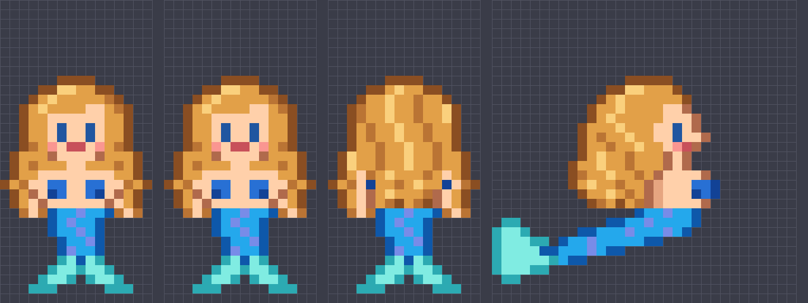

# Pixel Sirena for Pixel Agents

A pixel-art Sirena to keep as a pet in the [Pixel Agents](https://github.com/pixel-agents-hq/pixel-agents) office. She swims around the office and sometimes follows an agent. Click her and a heart appears.

   

This is a first draft. She was drawn by hand pixel by pixel from Sirena's painted art.

## Add her to your office

1. Download or clone this repo.
2. In Pixel Agents, open **Settings → Add Asset Directory** and pick this `pixel-agents` folder (the one with `assets/pets/sirena/` inside).
3. Open **Layout** and place Sirena in the office.

## Files

- `assets/pets/sirena/pet.png`: the 96×96 sheet. Row 0 is swimming toward you and resting, row 1 is swimming away and resting, row 2 is swimming to the right.
- `assets/pets/sirena/manifest.json`: her id and name.
- `make_pet.py`: draws `pet.png` from pixel grids (needs Python 3 with Pillow). Run `python make_pet.py`.

## License

Sirena, created by Anita (BrandAlchemyStudio). Only Anita may sell Sirena or use her commercially.

- **Art (pixel Sirena):** [CC BY-NC 4.0](../LICENSE). Non-commercial use only, and always credit her as **"Sirena, created by Anita (BrandAlchemyStudio)"** with a link to this repo.
- **Code (`make_pet.py`):** [PolyForm Noncommercial 1.0.0](../LICENSE).

Pixel Agents itself is a separate project by its own authors (MIT). It isn't part of this repo.
